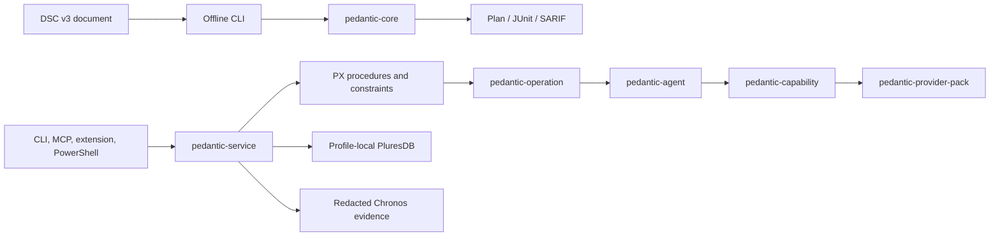

# Architecture

Pedantic separates declarative configuration work from the authority to cause
host effects. PX procedures and constraints are the authority for domain
decisions; adapters validate and execute only already-authorized work.

## Boundaries

### Offline core

`pedantic-core` parses DSC v3 documents, applies structural validation, builds
deterministic plans, and exports reports. This path has no service-store access
and does not execute DSC.

### Profile-local service

`pedantic-service` is the only live-store owner for a user/profile. Clients use
its versioned authenticated API rather than opening PluresDB directly. The
service evaluates PX constraints, serializes profile mutations, and publishes
redacted evidence projections.

### Durable execution

`pedantic-operation` models plans, settings resolution, authorization, and
event projections. `pedantic-agent` journals accepted effects durably and
checks grants. `pedantic-capability` validates typed adapter inputs and outputs;
provider packs implement the host-specific effects.

### Transport

`pedantic-transport` provides authenticated, transport-neutral envelopes. It
carries opaque payloads; enrollment, policy, and ordering remain service and
agent responsibilities.

## Security model

An effect is not executable merely because a configuration exists. A governed
operation needs a valid accepted request, required approval, and scoped
authorization. Configuration identity is bound to the raw document's SHA-256
digest. Evidence is redacted before projection, and service clients do not
receive live-store access.
